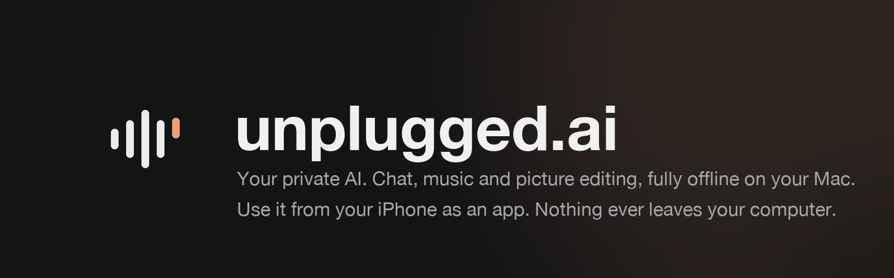
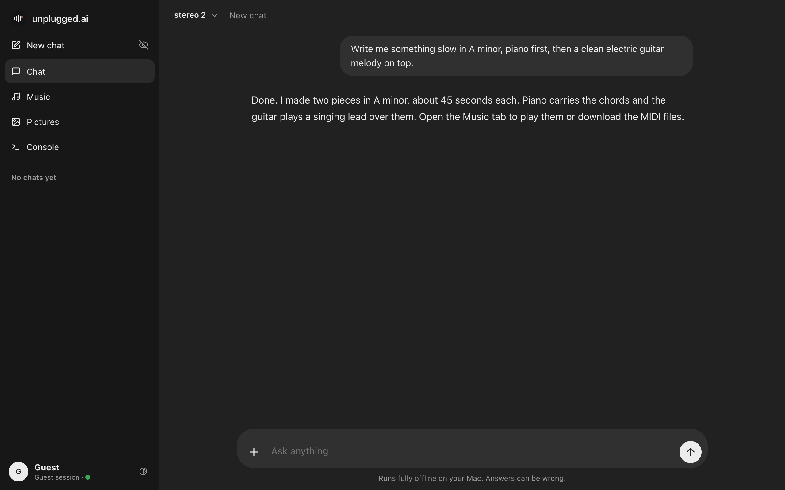
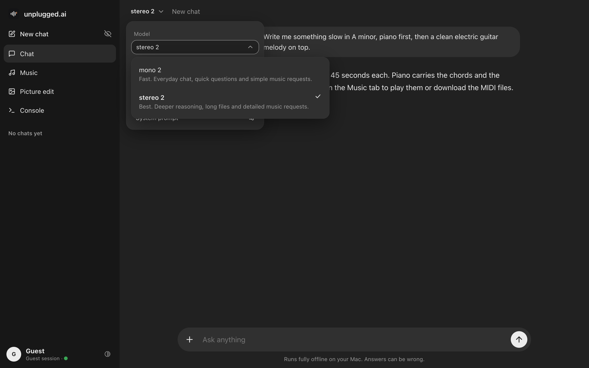
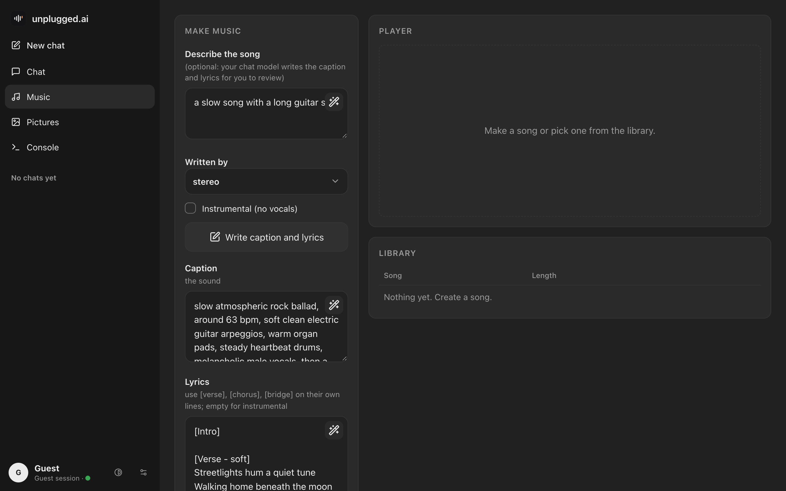
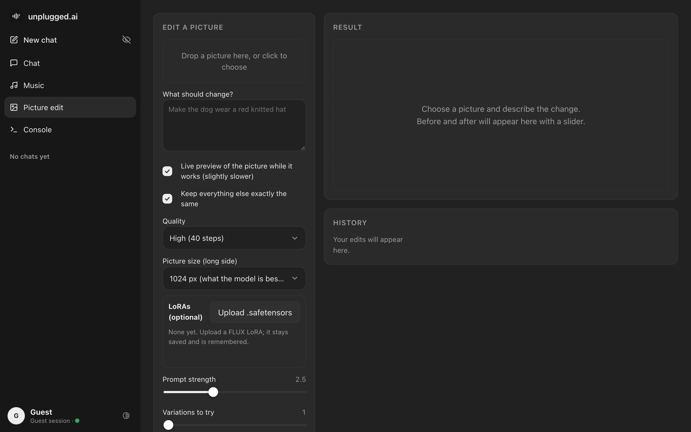
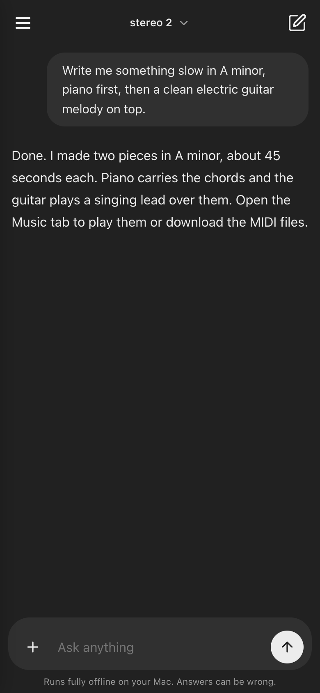
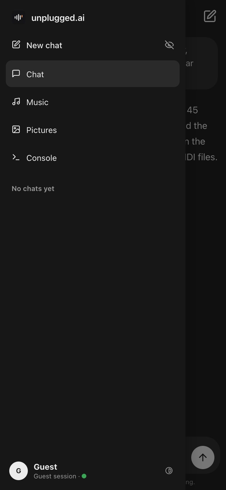
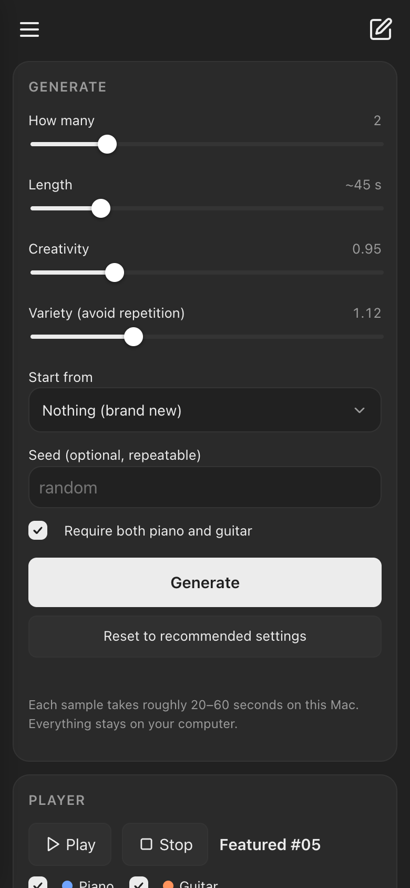
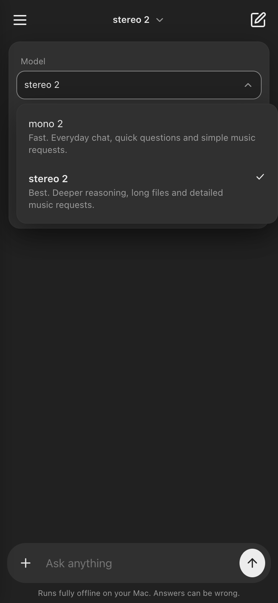

<p align="center"></p>

<p align="center">
<b>Your own private AI that runs entirely on your Mac.</b><br>
Chat with a local language model, write piano + electric guitar music with a model you train yourself,<br>
and edit pictures with FLUX Kontext. Open it from your iPhone over Wi-Fi. Nothing ever leaves your computer.
</p>

<p align="center">


</p>

---

## What you get

| | |
|---|---|
| **Chat** | A chatbot interface with two models: **stereo 2** (the stronger reasoning model, `gpt-oss:20b`) and **mono 2** (the lighter model, `qwen3:14b`). Both are the original Ollama models under app names; fine-tuned versions are planned and not available yet. Reasoning effort switch, tool calling, markdown, chat history, incognito chats. Attach files to a message: plain text and code files and Word (.docx) files were tested with both models; PDF, PowerPoint and Excel reading is implemented but untested. Binary files are accepted but the model says it cannot read them. |
| **Music** | A 35M-parameter GPT you train on MIDI. It writes piano and clean/driven electric guitar together trained on a broad mix of piano and guitar music. Ask for a piece in the chat and it appears there as a player with a piano roll, preview and MIDI downloads (both chat models can do this); the Music tab has a prompt box with a model picker (the chosen model reads your request) and advanced sliders. Name an artist or song and the piece starts from the opening of a real piece by them in your local training library, then continues as new music; if nobody by that name is in the library you get a general piece and are told so. |
| **Pictures** | FLUX.1 Kontext [dev] picture editing with live preview, automatic quality choice, LoRA support, before/after slider. Drop a picture into the chat, say what to change, done. |
| **Console** | A live log of everything the models are doing. |
| **Accounts** | Per-user history and settings, guest mode that deletes everything when you leave, incognito chats. |
| **iPhone** | Use it from the phone's browser; the Mac does the computing. Home-screen install and the offline shell are built but **not yet tested on a real iPhone**. |

<p align="center">


</p>
<p align="center">


</p>

<p align="center">




</p>

---

## Requirements

* A Mac with **Apple Silicon**. Developed and tested only on an M5 Pro with 24 GB. Other configurations are untested.
* macOS, **Homebrew**, **Python 3.11** and **Python 3.12**, **Ollama**, **git**.
* About **80 GB** of free disk: models (~25 GB), picture model download + 8-bit copy (~50 GB while converting), music training data (~2 GB).
* A free Hugging Face account (to accept the FLUX.1 Kontext license). The FLUX license is **non-commercial**.
* Internet only for the one-time downloads. After that everything runs offline.

## Install, step by step

### 1. Get the code

```bash
git clone https://github.com/lejacobdev/unplugged.ai.git
cd unplugged.ai
```

### 2. Language models (chat)

```bash
brew install ollama
ollama serve &              # or open the Ollama app
ollama pull gpt-oss:20b     # shown in the app as "stereo 2"
ollama pull qwen3:14b       # shown in the app as "mono 2"
```

The app shows its own names. To change the version number or swap a model, edit `MODEL_VERSION` and `MODEL_FAMILY` at the top of [`chat.py`](chat.py).

### 3. Python environments

```bash
brew install python@3.11 python@3.12

python3.11 -m venv .venv
.venv/bin/pip install -r requirements-music.txt

python3.12 -m venv .venv-img
.venv-img/bin/pip install -r requirements-image.txt
```

### 4. Picture model (optional, ~50 GB download)

```bash
./setup_image_model.sh
```

It walks you through accepting the license, logging in to Hugging Face, downloading FLUX.1 Kontext [dev] and saving an 8-bit copy in `models/kontext-q8` (about 12 GB). Safe to stop and re-run.

### 5. Music model (optional, a few hours of training)

The music model is a small GPT trained from scratch on piano and electric-guitar MIDI. The default model is **general**: it is trained on a broad mix of music and is not tuned to anyone's taste, so it works for everyone.

```bash
mkdir -p data && cd data

# general pretraining data: Lakh MIDI "clean" and MAESTRO v3
curl -L -O http://hog.ecs.columbia.edu/craffel/lmd/clean_midi.tar.gz
mkdir -p lakh && tar -xzf clean_midi.tar.gz -C lakh
curl -L -O https://storage.googleapis.com/magenta-data/datasets/maestro/v3.0.0/maestro-v3.0.0-midi.zip
mkdir -p base_midi && unzip -q maestro-v3.0.0-midi.zip -d base_midi
cd ..

# clean -> tokenize -> pretrain (writes ckpt/base, the general model)
caffeinate -dimsu ./run_all.sh
```

`run_all.sh` is resumable: stop it any time and run it again. Defaults are 230 minutes of pretraining (`BASE_MIN`) and a personal fine-tuning stage (`LORA_MIN`, see below). Keep the Mac plugged in; on battery it throttles hard. The app uses `ckpt/base` unless you set `UNPLUGGED_MUSIC_CKPT=/path/to/other/checkpoint`.

**Make it yours (optional).** The personal stage fine-tunes the general model on songs you choose. Copy [`examples/songs.example.md`](examples/songs.example.md) to `songs.md`, list your own songs, adjust the `CORE` table in [`clean_midi.py`](clean_midi.py), run `./run_all.sh` again and start the app with `UNPLUGGED_MUSIC_CKPT=ckpt/final`. In testing this changed held-out loss only slightly (3.134 to 3.094), so the general model is already close.

Notes on the pipeline and results are in [docs/music-model-notes.md](docs/music-model-notes.md).

Until a model exists in `ckpt/base`, the Music tab has nothing to generate with. Everything else still works.

### 6. Start it

```bash
./start.sh
```

Open **http://127.0.0.1:8000**. Create an account (the first thing you see is the sign-in page) or continue as a guest.

---

## Use it from your iPhone

> Status: the page is reachable from a phone on the same network (tested). The HTTPS certificate steps, Add to Home Screen and the offline shell are implemented but have **not been tested on a real iPhone yet**; expect to debug.

Your Mac does all the work; the phone is just a window. Both must be on the same Wi-Fi (or on the same VPN, for example [Tailscale](https://tailscale.com), if you want it away from home).

1. Start the app. The terminal prints an address like `http://192.168.x.x:8000` for your phone.
2. For the installable app with offline support iOS requires HTTPS. Run the one-time helper:
   ```bash
   ./setup_https.sh
   ```
   It creates a tiny private certificate authority that can only vouch for local names, and a certificate for your Mac.
3. On the iPhone open `http://<your-mac>.local:8000/ca.pem`, install the profile, then go to **Settings > General > About > Certificate Trust Settings** and switch it on.
4. Open the `https://<your-mac>.local:8443` address in Safari, sign in, tap **Share > Add to Home Screen**.

If the Mac is asleep or unreachable the app opens anyway and shows your saved chats, with a notice that sending needs the Mac.

> iOS web apps cannot use Bluetooth. The phone talks to the Mac over Wi-Fi or a VPN.

---

## Privacy and safety

* No cloud calls. Models, chats, pictures and music stay on your disk.
* Passwords are stored as salted scrypt hashes. Sessions use HttpOnly, SameSite=Strict cookies. Logins lock for 30 seconds after five wrong passwords.
* Everything except the sign-in page needs a login. Cross-site POSTs are rejected.
* Guest sessions live in memory and temp files and are deleted after 30 minutes idle, on sign-out, and on server restart. Incognito chats are never written to disk.
* If you expose the app beyond your home network, put it behind a VPN. It is not hardened for the open internet.

## How it works

```
browser / iPhone PWA  --HTTP(S)-->  server.py (Python stdlib)
                                       |-- chat.py     -> Ollama (stereo / mono), tool loop
                                       |-- imgedit.py  -> mflux (FLUX.1 Kontext, 8-bit)
                                       |-- generate.py -> self-trained 35M GPT (piano + guitar MIDI)
                                       |-- auth.py     -> accounts, sessions, per-user settings
                                       `-- logbus.py   -> live console
web/   index.html  chat.js  ui.js  store.js  app.css  sw.js  manifest.webmanifest
```

| File | Purpose |
|---|---|
| `server.py` | HTTP/HTTPS server, routes, tools the chat model can call (music, pictures) |
| `chat.py` | Chat storage, streaming, model names (`MODEL_VERSION`, `MODEL_FAMILY`) |
| `imgedit.py` | Picture jobs, quality auto-pick, LoRAs, live preview |
| `train.py`, `finetune_lora.py`, `generate.py` | Music model training and sampling |
| `clean_midi.py`, `prep_tokens.py`, `rank_songs.py` | Data preparation |
| `gen_icons.py` | Draws the app icons and logo |
| `setup_https.sh`, `setup_image_model.sh` | One-time helpers |

## Troubleshooting

| Problem | Fix |
|---|---|
| "Ollama is not running" banner | Open the Ollama app or run `ollama serve`, then reload. |
| Chat is very slow | A picture edit or training job is running and shares memory. Wait for it, or plug the Mac in. |
| Picture edit takes minutes per step | The Mac is on battery. Plug in the charger. |
| iPhone says the site is not secure | Install the CA profile and enable it under Certificate Trust Settings (step 3 above). |
| Port already in use | `JACOBAI_PORT=8001 JACOBAI_TLS_PORT=8444 ./start.sh` |
| Restarting the server stopped my edit | Jobs live in the server's memory; check that nothing is running before restarting. |

## Credits and licenses

* Code: MIT (see `LICENSE`).
* [FLUX.1 Kontext [dev]](https://huggingface.co/black-forest-labs/FLUX.1-Kontext-dev) by Black Forest Labs: non-commercial license. Run through [mflux](https://github.com/filipstrand/mflux).
* [gpt-oss](https://ollama.com/library/gpt-oss) and [Qwen3](https://ollama.com/library/qwen3) via [Ollama](https://ollama.com).
* Training data: [Lakh MIDI](https://colinraffel.com/projects/lmd/) (CC BY 4.0) and [MAESTRO](https://magenta.tensorflow.org/datasets/maestro) (CC BY-NC-SA 4.0). The datasets are not included in this repository, and neither are any trained weights.
