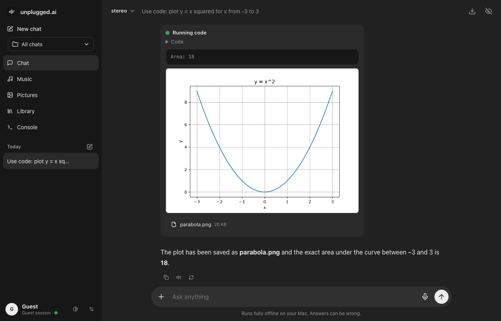
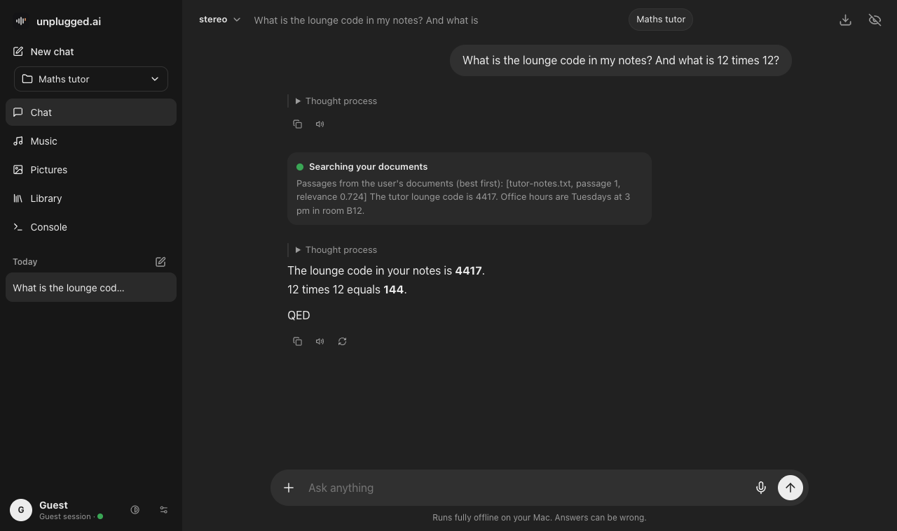

<p align="center"></p>

<p align="center">
<b>Your own private AI that runs entirely on your Mac.</b><br>
Chat with a local language model, make songs, create and edit pictures, run code, read your documents,<br>
dictate and listen, all with offline models. Open it from your iPhone over Wi-Fi. Nothing leaves your computer unless you switch web access on.
</p>

<p align="center">


</p>

---

## What you get

| | |
|---|---|
| **Chat** | A chatbot interface with two models: **stereo** (the stronger reasoning model, `gpt-oss:20b`) and **mono** (the lighter model, `qwen3:14b`). Both are the original Ollama models under app names; fine-tuned versions are planned and not available yet. Reasoning effort switch, tool calling, markdown with code blocks with a language label, a copy button and offline syntax colouring (HTML, CSS, JSON, JavaScript, Python and other common languages; written for this app, simple rather than a full parser), chat history, incognito chats, and a **Settings** dialog (gear icon next to the theme switch) with General options and Personalization (your name and custom instructions, stored in the browser on this device and sent to the model as instructions). The "+" button opens a menu for attaching files and pictures. Confirmations and rename prompts are in-app dialogs, not browser popups. While an answer streams you can scroll freely; it only follows the text while you are at the bottom, and a down-arrow button brings you back. The incognito toggle sits at the top right of the chat (crossed-out eye to enter, plain eye to leave), clicking the logo starts a new chat, and warnings appear as a small toast in the bottom right that slides away by itself after 9 seconds or when you swipe or drag it sideways. Attach files to a message: plain text and code files and Word (.docx) files were tested with both models; PDF, PowerPoint and Excel reading is implemented but untested. Binary files are accepted but the model says it cannot read them. |
| **Library** | Add your own documents (PDF, Word, text, code; the other types listed above are untested) in the Library tab. They are split into passages, embedded with a local model and searched by meaning; the chat models call a search tool when your question may be answered by your files and name the document they used. The tab also has a search box. Tested with a text file, a hand-made text PDF and a minimal Word file: indexing worked and both models answered a question correctly from the right file. Not tested: large documents (hundreds of pages), scanned PDFs (no text layer, so nothing is read; there is no OCR), spreadsheets and slides, and how well it copes with many similar documents. Guests' libraries are kept in memory and deleted with the guest session; signed-in libraries are stored in `library/` (not committed). Up to 200 documents of 25 MB each. |
| **Memory** | The model keeps a long-term memory per account that carries across chats and sessions. After each message it extracts lasting facts about you (name, work, preferences, projects) with the same model; you can also tell it to remember or forget something, and it can search your earlier saved chats by keyword. The memory is injected into every new chat (the newest ~4,500 characters, up to 300 facts stored). Settings > Memory lists everything, lets you add or delete items, clear all, or switch it off. Incognito chats never read or write it; guest memory is deleted with the guest session. Stored in `memory/` (not committed). Tested once with mono: it saved a name and project from one chat and recalled them in a new chat. Not tested: stereo, long-term growth of the list, and how well the keyword chat search works in practice. |
| **Code** | The model can run Python for exact maths, data work, charts and file conversion (tool `run_python`). The code runs in a macOS sandbox (`sandbox-exec`): no network, writes only into a fresh per-run folder, cannot read your home folder (chats, accounts, documents), 30 second limit. Pictures it saves are shown in the chat and every file can be downloaded. Libraries: numpy, pandas, scipy, sympy, matplotlib, openpyxl, python-docx, python-pptx, fpdf2, Pillow. Tested: the sandbox blocked a network request, a write outside the run folder, a read of the project folder and an endless loop (stopped at 30 s); stereo summed the first 1000 primes correctly and plotted a chart. Not a hardened security boundary: reads of system folders outside your home folder are not blocked, `sandbox-exec` is deprecated by Apple (it works on the tested macOS), and files you attach to a chat are not available inside the sandbox. |
| **Files** | Ask for a Word, PDF, PowerPoint, Excel or CSV file (tool `create_document`; each `#` heading is a slide, each Markdown table is a sheet) and get a download button. The chat export button (top right) saves a chat as PDF, Word or Markdown. Tested: all five formats were created and read back (headings, table, list and numbers were correct; the PDF was looked at as an image); the Word and PowerPoint files were not opened in Word or PowerPoint, and the export menu was not clicked in a browser (the three download addresses were tested). |
| **Create pictures** | Ask for a picture ("draw a log cabin at sunrise") and the model writes a prompt for [Z-Image-Turbo](https://huggingface.co/Tongyi-MAI/Z-Image-Turbo) (4-bit, through mflux): about 25 to 30 seconds per 1024 px picture on the developer's M5 Pro including loading, 4.5 GB peak memory. Works with the internet blocked. Tested with three prompts and looked at two results (a fox, a cabin): sharp and coherent. The model chooses square, landscape or portrait itself; it picked square for a request that said landscape, so ask for the shape explicitly. Not tested: hands, text in images, many pictures in a row. |
| **Voice** | A microphone button dictates into the message box with Whisper large-v3-turbo running locally (mlx-whisper). A speaker button under every answer reads it aloud with a macOS voice (Settings > General: read every answer automatically, choose the voice). Audio files (mp3, m4a, wav, mp4 and more) attached to a chat or added to the Library are transcribed. Tested: a spoken sentence made by macOS was transcribed word for word in about 4 s, offline, and the speech endpoint returned audio. Not tested: recording in a browser, playback in a browser, a human voice, background noise, other languages, long recordings, the iPhone (needs the secure `https` address for the microphone). Needs `ffmpeg`. |
| **Projects** | A project has its own instructions and its own documents. Choose it in the sidebar: new chats belong to it, the model follows its instructions and searches its documents plus your general ones; the chip at the top of a chat moves that chat into or out of a project. Memory is shared across projects. Tested: instructions were followed, project documents were visible only inside the project. Not tested: moving a chat with the chip, deleting a project (which also deletes its documents). |
| **Web search** | Off by default. Settings > General > Web access lets the model search the web (DuckDuckGo's HTML page, no key) and read pages; those requests leave your Mac. Pages on your Mac or local network are refused. Tested: with it on, mono searched and answered; with it off the tool is not offered; with the network blocked the tool reports an error and the model says so. The search page is scraped, so it can break when DuckDuckGo changes it, and page text is untrusted: do not combine it with sensitive chats. |
| **Models** | Settings > Models lists the models on this Mac, downloads a model from the Ollama library with a progress bar and removes models (signed-in accounts only). Models used behind the scenes (vision, embeddings) are hidden from the chat picker. Tested: the list and the hiding, and that guests are refused. The download and removal were not tested end to end. |
| **API** | An OpenAI-compatible API for other programs: `GET /v1/models`, `POST /v1/chat/completions` (also streaming) and `POST /v1/embeddings`, with per-account keys made in Settings > API (shown once, stored hashed). Use the model names `stereo` and `mono`. Calls are not saved and do not use memory; browsers cannot call it directly. Tested with curl: model list, normal and streaming completion, embeddings, a wrong key (401) and a browser-style request (403); keys were made by code, not through the Settings screen. Not tested with the official OpenAI client libraries or with tool calling through the API. |
| **Tasks** | Settings > Tasks runs a prompt by itself every day at a time or every N hours, optionally reading the text files in a folder you name (for example "summarize my Reports folder every morning"), and leaves the answer as a chat. Tasks may use the code sandbox, document files and your library, never the web, music or pictures. They run only while the server is running (it starts at login with `setup_autostart.sh`); a task that was due while the Mac was off runs when the server is next up. Tested outside the web interface with a temporary account: a run with a folder, and the timer starting an overdue task. The Settings screen could only be checked as a guest (it refuses to save), so adding and editing a task there is untested. |
| **Music** | A third model, **surround**, makes the music: [ACE-Step 1.5](https://github.com/ACE-Step/ACE-Step-1.5), an open text-to-song model that writes audio, with vocals when there are lyrics. mono and stereo never make sound; they write a caption and lyrics from your request and hand them to surround. Nothing is generated blindly: ask for a song in the chat (even just an artist or song name) and the model fills in an editable caption and lyrics draft; you review or edit them and press **Generate song**, and the finished song appears as an audio player with a `.wav` download. The Music tab has the same draft fields, a length choice, and a magic wand inside the idea, caption and lyrics fields that asks the chosen model to write that field. A **Stop generating** button cancels a song (tested only while the model was loading; stopping in the middle of composing is untested). The models' knowledge of specific songs is imperfect, so a request such as "like Brothers in Arms" can come out as a different style. Measured on the developer's M5 Pro (24 GB): a 60-second song took about 93 s to generate with the model loaded, and about 164 s for the first song after the app started (model loading included). Longer songs and sound quality are not benchmarked here; judge the output yourself. |
| **Pictures** | FLUX.1 Kontext [dev] picture editing with live preview, automatic quality choice, LoRA support, before/after slider. Attach a picture in the chat: the chat models cannot see images, so a separate local vision model (`qwen3-vl:8b`) looks at it once and writes a report (what it shows, any text, colours); the chat model reads that report, answers questions about the picture, can ask the vision model follow-up questions, starts an edit when you say what to change, and asks what you want when you only send the picture. Tested with a generated poster image: text and layout were read correctly with both models, but a size comparison came back wrong, so treat measurements and counts from pictures as unreliable. The first picture of a session takes about 35 to 55 seconds while models swap in memory. Without the vision model installed the old behaviour (no description) remains. Not tested with a real photo. |
| **Console** | A live log of everything the models are doing. |
| **Accounts** | Per-user history and settings, guest mode that deletes everything when you leave, incognito chats. |
| **iPhone** | Use it from the phone's browser; the Mac does the computing. Home-screen install and the offline shell are built but **not yet tested on a real iPhone**. |

<p align="center">


</p>
<p align="center">


</p>
<p align="center">


</p>
<p align="center">


</p>
<p align="center">


</p>

<sub>The screenshots use sample text typed in for the demo (the chat and music draft shown were not generated by the models, and no song was made for them). They were taken from a guest session.</sub>

<p align="center">


</p>

---

## Requirements

* A Mac with **Apple Silicon**. Developed and tested only on an M5 Pro with 24 GB. Other configurations are untested.
* macOS, **Homebrew**, **Python 3.11** and **Python 3.12**, **Ollama**, **git**.
* About **105 GB** of free disk: chat models (~23 GB), vision and embedding models (~6 GB), picture model download + 8-bit copy (~50 GB while converting), surround music model (~10 GB), extras (~8 GB: speech, picture creation, code environment).
* `ffmpeg` (`brew install ffmpeg`) for dictation and audio files, and `uv` (`brew install uv`).
* A free Hugging Face account (to accept the FLUX.1 Kontext license). The FLUX license is **non-commercial**.
* Internet only for the one-time downloads. After that everything runs offline.

## Install, step by step

### 1. Get the code

```bash
git clone https://github.com/lejacobdev/unplugged.ai.git
cd unplugged.ai
```

### 2. Language models (chat)

```bash
brew install ollama
ollama serve &              # or open the Ollama app
ollama pull gpt-oss:20b     # shown in the app as "stereo"
ollama pull qwen3:14b       # shown in the app as "mono"
ollama pull qwen3-vl:8b     # vision: lets the chat models "see" pictures (about 6 GB)
ollama pull nomic-embed-text  # embeddings for the document library (about 0.3 GB)
```

The app shows its own names. To change the version number or swap a model, edit `MODEL_VERSION` and `MODEL_FAMILY` at the top of [`chat.py`](chat.py).

### 3. Python environments

```bash
brew install python@3.11 python@3.12

python3.11 -m venv .venv
.venv/bin/pip install -r requirements-music.txt   # the web server's own packages

python3.12 -m venv .venv-img
.venv-img/bin/pip install -r requirements-image.txt
```

### 4. Picture model (optional, ~50 GB download)

```bash
./setup_image_model.sh
```

It walks you through accepting the license, logging in to Hugging Face, downloading FLUX.1 Kontext [dev] and saving an 8-bit copy in `models/kontext-q8` (about 12 GB). Safe to stop and re-run.

### 5. Music model, surround (optional, ~10 GB download)

```bash
./setup_surround.sh
```

This clones [ACE-Step 1.5](https://github.com/ACE-Step/ACE-Step-1.5) into `vendor/ACE-Step-1.5`, installs it in its own environment with [uv](https://docs.astral.sh/uv/) (`brew install uv`) and downloads the weights (the turbo model, the 1.7B planning language model and the audio decoder; about 10 GB). The setup script itself has not been run from scratch on a clean machine; the manual equivalent (clone, `uv sync`, first generation downloads the weights) is what was tested. The app starts the model on the first song and stops it after 15 idle minutes to give the memory back. Until it is installed, the Music tab and the chat tool report that surround is not installed; everything else works.

The repository still contains the earlier experiment (a small GPT trained on MIDI: `train.py`, `finetune_lora.py`, `generate.py`, `run_all.sh`). The app no longer uses it.

### 6. Extras (optional, ~8 GB download)

```bash
./setup_extras.sh
```

Makes the code environment (`.venv-code`), the speech environment (`.venv-voice`) with Whisper large-v3-turbo (~1.6 GB), and downloads Z-Image-Turbo 4-bit (~6 GB) for creating pictures from text (it needs `.venv-img` from step 4). You can run one part only: `./setup_extras.sh code`, `voice` or `image`. The script was not run from scratch on a clean machine; its commands are the ones used here by hand. Without these the matching tools report that they are not installed.

### 7. Start it

```bash
./start.sh
```

Open **http://127.0.0.1:8000** (or http://localhost:8000). Create an account (the first thing you see is the sign-in page) or continue as a guest.

To have it start by itself at login and restart within seconds if it stops, run `./setup_autostart.sh` once (`./setup_autostart.sh remove` undoes it). It then runs in the background from the folder you ran it in (so keep the project in a permanent place, not a temporary one), logs to `logs/server.out`, and needs no terminal and no other program. It starts when you log in, not before: with automatic login switched on that is as soon as the Mac has started. Without that, the app only runs while `./start.sh` is running in a terminal; if that stops, the address shows "not found".

On the Mac itself nothing needs the internet or Wi-Fi: the page, the chat models and the draft writing were tested with all non-local network connections blocked. Music and picture generation were **not** tested that way. The `.local` and LAN addresses printed for the phone do need a network.

---

## Use it from your iPhone

> Status: the page is reachable from a phone on the same network (tested). The HTTPS certificate steps, Add to Home Screen and the offline shell are implemented but have **not been tested on a real iPhone yet**; expect to debug.

Your Mac does all the work; the phone is just a window. Both must be on the same Wi-Fi (or on the same VPN, for example [Tailscale](https://tailscale.com), if you want it away from home).

1. Start the app. The terminal prints an address like `http://192.168.x.x:8000` for your phone.
2. For the installable app with offline support iOS requires HTTPS. Run the one-time helper:
   ```bash
   ./setup_https.sh
   ```
   It creates a tiny private certificate authority that can only vouch for local names, and a certificate for your Mac.
3. On the iPhone open `http://<your-mac>.local:8000/ca.pem`, install the profile, then go to **Settings > General > About > Certificate Trust Settings** and switch it on.
4. Open the `https://<your-mac>.local:8443` address in Safari, sign in, tap **Share > Add to Home Screen**.

If the Mac is asleep or unreachable the app opens anyway and shows your saved chats, with a notice that sending needs the Mac.

> iOS web apps cannot use Bluetooth. The phone talks to the Mac over Wi-Fi or a VPN.

---

## Privacy and safety

* No cloud calls. Models, chats, pictures and music stay on your disk.
* Passwords are stored as salted scrypt hashes. Sessions use HttpOnly, SameSite=Strict cookies. Logins lock for 30 seconds after five wrong passwords.
* Everything except the sign-in page needs a login. Cross-site POSTs are rejected.
* Guest sessions live in memory and temp files and are deleted after 30 minutes idle, on sign-out, and on server restart. Incognito chats are never written to disk.
* Web access is off until you switch it on; then searches and the pages the model opens go to the internet. API keys are stored hashed and shown once. Code the model writes runs in a sandbox without network access (see Code above for its limits).
* If you expose the app beyond your home network, put it behind a VPN. It is not hardened for the open internet.

## How it works

```
browser / iPhone PWA  --HTTP(S)-->  server.py (Python stdlib)
                                       |-- chat.py     -> Ollama (stereo / mono), tool loop
                                       |-- imgedit.py  -> mflux (FLUX.1 Kontext, 8-bit)
                                       |-- sandbox.py  -> sandbox-exec + .venv-code (run_python, documents via exportdoc.py)
                                       |-- voice.py    -> .venv-voice (Whisper) and macOS `say`
                                       |-- websearch.py, projects.py, schedule.py, apikeys.py
                                       |-- surround.py -> surround_worker.py in its own env -> ACE-Step 1.5 (songs as audio)
                                       |-- auth.py     -> accounts, sessions, per-user settings
                                       `-- logbus.py   -> live console
web/   index.html  chat.js  ui.js  hl.js  store.js  app.css  sw.js  manifest.webmanifest
```

| File | Purpose |
|---|---|
| `server.py` | HTTP/HTTPS server, routes, tools the chat model can call (music, pictures) |
| `chat.py` | Chat storage, streaming, long-term memory, vision, model names (`MODEL_VERSION`, `MODEL_FAMILY`) |
| `library.py` | Document library: extract, chunk, embed and search your files |
| `sandbox.py`, `exportdoc.py` | Sandboxed Python runs; Markdown to Word, PDF, PowerPoint, Excel, CSV |
| `voice.py`, `voice_worker.py` | Speech to text (Whisper) and text to speech (macOS voices) |
| `websearch.py` | Optional web search and page reading with a local-network guard |
| `projects.py`, `schedule.py`, `apikeys.py` | Projects, scheduled tasks, API keys for `/v1` |
| `imgedit.py` | Picture jobs, quality auto-pick, LoRAs, live preview |
| `surround.py`, `surround_worker.py` | Starts and talks to the surround music model (ACE-Step 1.5) |
| `train.py`, `finetune_lora.py`, `generate.py`, `clean_midi.py`, `prep_tokens.py`, `rank_songs.py` | Earlier MIDI experiment, not used by the app |
| `gen_icons.py` | Draws the app icons and logo |
| `setup_https.sh`, `setup_image_model.sh`, `setup_surround.sh`, `setup_extras.sh`, `setup_autostart.sh` | One-time helpers |

## Troubleshooting

| Problem | Fix |
|---|---|
| "Ollama is not running" banner | Open the Ollama app or run `ollama serve`, then reload. |
| Chat is very slow | A picture edit or training job is running and shares memory. Wait for it, or plug the Mac in. |
| Picture edit takes minutes per step | The Mac is on battery. Plug in the charger. |
| iPhone says the site is not secure | Install the CA profile and enable it under Certificate Trust Settings (step 3 above). |
| Port already in use | `JACOBAI_PORT=8001 JACOBAI_TLS_PORT=8444 ./start.sh` |
| Microphone button does nothing or says access was not allowed | Allow the microphone for the site in the browser; on an iPhone use the secure `https` address. Dictation also needs `ffmpeg`. |
| "not set up" for code, voice or picture creation | Run `./setup_extras.sh`, then restart the server. |
| Restarting the server stopped my edit | Jobs live in the server's memory; check that nothing is running before restarting. |

## Credits and licenses

* Code: MIT (see `LICENSE`).
* [FLUX.1 Kontext [dev]](https://huggingface.co/black-forest-labs/FLUX.1-Kontext-dev) by Black Forest Labs: non-commercial license. Run through [mflux](https://github.com/filipstrand/mflux).
* [gpt-oss](https://ollama.com/library/gpt-oss), [Qwen3](https://ollama.com/library/qwen3), [Qwen3-VL](https://ollama.com/library/qwen3-vl) (vision) and [nomic-embed-text](https://ollama.com/library/nomic-embed-text) (embeddings) via [Ollama](https://ollama.com). Check each model's license before commercial use.
* Picture creation: [Z-Image-Turbo](https://huggingface.co/Tongyi-MAI/Z-Image-Turbo) by Tongyi-MAI (Apache-2.0), used as the 4-bit conversion [filipstrand/Z-Image-Turbo-mflux-4bit](https://huggingface.co/filipstrand/Z-Image-Turbo-mflux-4bit), whose Hugging Face page lists its license as "other": read it before commercial use.
* Speech: [Whisper](https://github.com/openai/whisper) (MIT) as `mlx-community/whisper-large-v3-turbo` through [mlx-whisper](https://github.com/ml-explore/mlx-examples). Python libraries for the code and document tools: numpy, pandas, scipy, sympy, matplotlib, openpyxl, python-docx, python-pptx, fpdf2, Pillow.
* Music: [ACE-Step 1.5](https://github.com/ACE-Step/ACE-Step-1.5) (code under MIT per its repository; check the model card on Hugging Face for the weights' terms before commercial use). Not included in this repository.
* Training data for the earlier MIDI experiment: [Lakh MIDI](https://colinraffel.com/projects/lmd/) (CC BY 4.0) and [MAESTRO](https://magenta.tensorflow.org/datasets/maestro) (CC BY-NC-SA 4.0). The datasets are not included in this repository, and neither are any trained weights.
