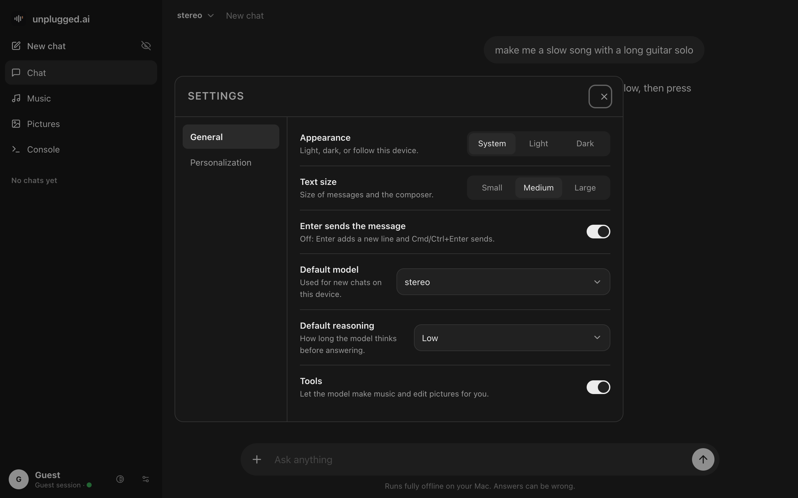
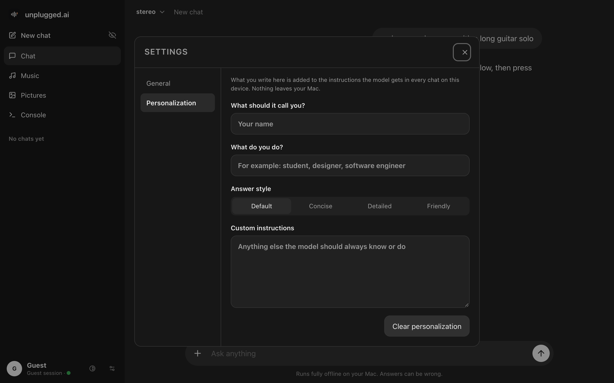
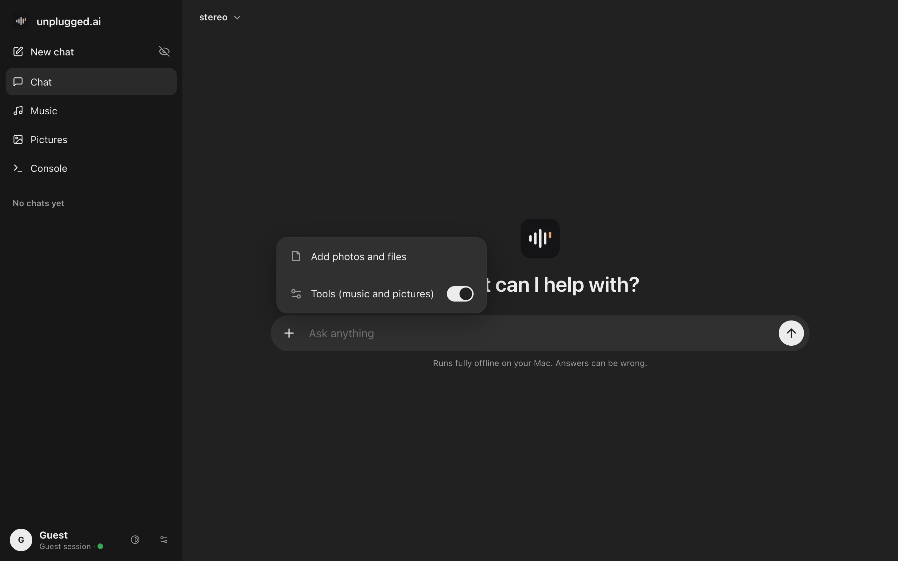
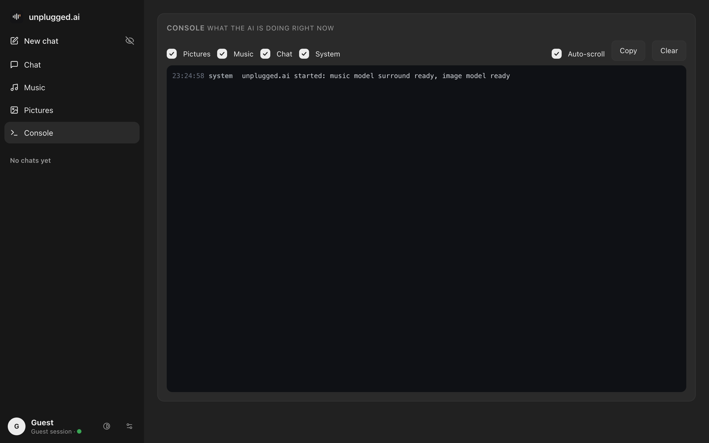
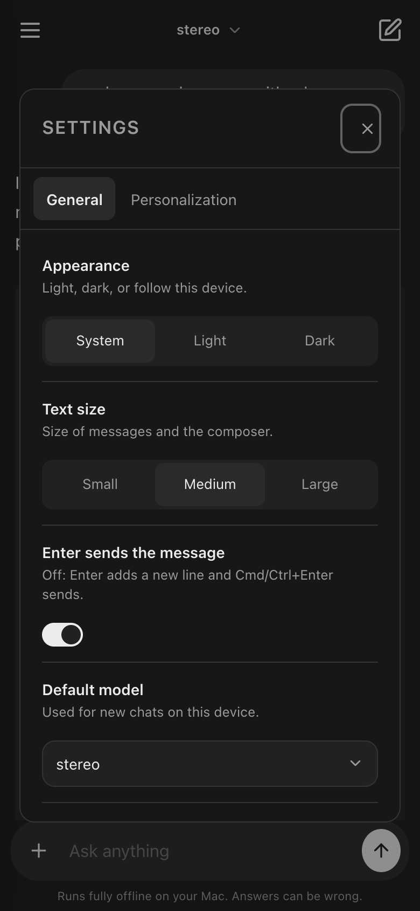

<p align="center"></p>

<p align="center">
<b>Your own private AI that runs entirely on your Mac.</b><br>
Chat with a local language model, make songs with an offline music model,<br>
and edit pictures with FLUX Kontext. Open it from your iPhone over Wi-Fi. Nothing ever leaves your computer.
</p>

<p align="center">


</p>

---

## What you get

| | |
|---|---|
| **Chat** | A chatbot interface with two models: **stereo** (the stronger reasoning model, `gpt-oss:20b`) and **mono** (the lighter model, `qwen3:14b`). Both are the original Ollama models under app names; fine-tuned versions are planned and not available yet. Reasoning effort switch, tool calling, markdown with code blocks that have a language label and a copy button, chat history, incognito chats, and a **Settings** dialog (gear icon next to the theme switch) with General options and Personalization (your name and custom instructions, stored in the browser on this device and sent to the model as instructions). The "+" button opens a menu for attaching files and pictures. Confirmations and rename prompts are in-app dialogs, not browser popups. Attach files to a message: plain text and code files and Word (.docx) files were tested with both models; PDF, PowerPoint and Excel reading is implemented but untested. Binary files are accepted but the model says it cannot read them. |
| **Music** | A third model, **surround**, makes the music: [ACE-Step 1.5](https://github.com/ACE-Step/ACE-Step-1.5), an open text-to-song model that writes audio, with vocals when there are lyrics. mono and stereo never make sound; they write a caption and lyrics from your request and hand them to surround. Nothing is generated blindly: ask for a song in the chat (even just an artist or song name) and the model fills in an editable caption and lyrics draft; you review or edit them and press **Generate song**, and the finished song appears as an audio player with a `.wav` download. The Music tab has the same draft fields, a length choice, and a magic wand inside the idea, caption and lyrics fields that asks the chosen model to write that field. A **Stop generating** button cancels a song (tested only while the model was loading; stopping in the middle of composing is untested). The models' knowledge of specific songs is imperfect, so a request such as "like Brothers in Arms" can come out as a different style. Measured on the developer's M5 Pro (24 GB): a 60-second song took about 93 s to generate with the model loaded, and about 164 s for the first song after the app started (model loading included). Longer songs and sound quality are not benchmarked here; judge the output yourself. |
| **Pictures** | FLUX.1 Kontext [dev] picture editing with live preview, automatic quality choice, LoRA support, before/after slider. Attach a picture in the chat: the chat model (which cannot see images) works out from your message what you want; if you say what to change it starts the edit, and if you only send the picture or an unclear message it asks what you would like to do (this picture-intent behaviour was changed last and has not been tested with a real picture yet). |
| **Console** | A live log of everything the models are doing. |
| **Accounts** | Per-user history and settings, guest mode that deletes everything when you leave, incognito chats. |
| **iPhone** | Use it from the phone's browser; the Mac does the computing. Home-screen install and the offline shell are built but **not yet tested on a real iPhone**. |

<p align="center">


</p>
<p align="center">


</p>
<p align="center">


</p>
<p align="center">


</p>

<sub>The screenshots use sample text typed in for the demo (the chat and music draft shown were not generated by the models, and no song was made for them). They were taken from a guest session.</sub>

<p align="center">



</p>

---

## Requirements

* A Mac with **Apple Silicon**. Developed and tested only on an M5 Pro with 24 GB. Other configurations are untested.
* macOS, **Homebrew**, **Python 3.11** and **Python 3.12**, **Ollama**, **git**.
* About **90 GB** of free disk: models (~25 GB), picture model download + 8-bit copy (~50 GB while converting), surround music model (~10 GB).
* A free Hugging Face account (to accept the FLUX.1 Kontext license). The FLUX license is **non-commercial**.
* Internet only for the one-time downloads. After that everything runs offline.

## Install, step by step

### 1. Get the code

```bash
git clone https://github.com/lejacobdev/unplugged.ai.git
cd unplugged.ai
```

### 2. Language models (chat)

```bash
brew install ollama
ollama serve &              # or open the Ollama app
ollama pull gpt-oss:20b     # shown in the app as "stereo"
ollama pull qwen3:14b       # shown in the app as "mono"
```

The app shows its own names. To change the version number or swap a model, edit `MODEL_VERSION` and `MODEL_FAMILY` at the top of [`chat.py`](chat.py).

### 3. Python environments

```bash
brew install python@3.11 python@3.12

python3.11 -m venv .venv
.venv/bin/pip install -r requirements-music.txt   # the web server's own packages

python3.12 -m venv .venv-img
.venv-img/bin/pip install -r requirements-image.txt
```

### 4. Picture model (optional, ~50 GB download)

```bash
./setup_image_model.sh
```

It walks you through accepting the license, logging in to Hugging Face, downloading FLUX.1 Kontext [dev] and saving an 8-bit copy in `models/kontext-q8` (about 12 GB). Safe to stop and re-run.

### 5. Music model, surround (optional, ~10 GB download)

```bash
./setup_surround.sh
```

This clones [ACE-Step 1.5](https://github.com/ACE-Step/ACE-Step-1.5) into `vendor/ACE-Step-1.5`, installs it in its own environment with [uv](https://docs.astral.sh/uv/) (`brew install uv`) and downloads the weights (the turbo model, the 1.7B planning language model and the audio decoder; about 10 GB). The setup script itself has not been run from scratch on a clean machine; the manual equivalent (clone, `uv sync`, first generation downloads the weights) is what was tested. The app starts the model on the first song and stops it after 15 idle minutes to give the memory back. Until it is installed, the Music tab and the chat tool report that surround is not installed; everything else works.

The repository still contains the earlier experiment (a small GPT trained on MIDI: `train.py`, `finetune_lora.py`, `generate.py`, `run_all.sh`). The app no longer uses it.

### 6. Start it

```bash
./start.sh
```

Open **http://127.0.0.1:8000**. Create an account (the first thing you see is the sign-in page) or continue as a guest.

---

## Use it from your iPhone

> Status: the page is reachable from a phone on the same network (tested). The HTTPS certificate steps, Add to Home Screen and the offline shell are implemented but have **not been tested on a real iPhone yet**; expect to debug.

Your Mac does all the work; the phone is just a window. Both must be on the same Wi-Fi (or on the same VPN, for example [Tailscale](https://tailscale.com), if you want it away from home).

1. Start the app. The terminal prints an address like `http://192.168.x.x:8000` for your phone.
2. For the installable app with offline support iOS requires HTTPS. Run the one-time helper:
   ```bash
   ./setup_https.sh
   ```
   It creates a tiny private certificate authority that can only vouch for local names, and a certificate for your Mac.
3. On the iPhone open `http://<your-mac>.local:8000/ca.pem`, install the profile, then go to **Settings > General > About > Certificate Trust Settings** and switch it on.
4. Open the `https://<your-mac>.local:8443` address in Safari, sign in, tap **Share > Add to Home Screen**.

If the Mac is asleep or unreachable the app opens anyway and shows your saved chats, with a notice that sending needs the Mac.

> iOS web apps cannot use Bluetooth. The phone talks to the Mac over Wi-Fi or a VPN.

---

## Privacy and safety

* No cloud calls. Models, chats, pictures and music stay on your disk.
* Passwords are stored as salted scrypt hashes. Sessions use HttpOnly, SameSite=Strict cookies. Logins lock for 30 seconds after five wrong passwords.
* Everything except the sign-in page needs a login. Cross-site POSTs are rejected.
* Guest sessions live in memory and temp files and are deleted after 30 minutes idle, on sign-out, and on server restart. Incognito chats are never written to disk.
* If you expose the app beyond your home network, put it behind a VPN. It is not hardened for the open internet.

## How it works

```
browser / iPhone PWA  --HTTP(S)-->  server.py (Python stdlib)
                                       |-- chat.py     -> Ollama (stereo / mono), tool loop
                                       |-- imgedit.py  -> mflux (FLUX.1 Kontext, 8-bit)
                                       |-- surround.py -> surround_worker.py in its own env -> ACE-Step 1.5 (songs as audio)
                                       |-- auth.py     -> accounts, sessions, per-user settings
                                       `-- logbus.py   -> live console
web/   index.html  chat.js  ui.js  store.js  app.css  sw.js  manifest.webmanifest
```

| File | Purpose |
|---|---|
| `server.py` | HTTP/HTTPS server, routes, tools the chat model can call (music, pictures) |
| `chat.py` | Chat storage, streaming, model names (`MODEL_VERSION`, `MODEL_FAMILY`) |
| `imgedit.py` | Picture jobs, quality auto-pick, LoRAs, live preview |
| `surround.py`, `surround_worker.py` | Starts and talks to the surround music model (ACE-Step 1.5) |
| `train.py`, `finetune_lora.py`, `generate.py`, `clean_midi.py`, `prep_tokens.py`, `rank_songs.py` | Earlier MIDI experiment, not used by the app |
| `gen_icons.py` | Draws the app icons and logo |
| `setup_https.sh`, `setup_image_model.sh`, `setup_surround.sh` | One-time helpers |

## Troubleshooting

| Problem | Fix |
|---|---|
| "Ollama is not running" banner | Open the Ollama app or run `ollama serve`, then reload. |
| Chat is very slow | A picture edit or training job is running and shares memory. Wait for it, or plug the Mac in. |
| Picture edit takes minutes per step | The Mac is on battery. Plug in the charger. |
| iPhone says the site is not secure | Install the CA profile and enable it under Certificate Trust Settings (step 3 above). |
| Port already in use | `JACOBAI_PORT=8001 JACOBAI_TLS_PORT=8444 ./start.sh` |
| Restarting the server stopped my edit | Jobs live in the server's memory; check that nothing is running before restarting. |

## Credits and licenses

* Code: MIT (see `LICENSE`).
* [FLUX.1 Kontext [dev]](https://huggingface.co/black-forest-labs/FLUX.1-Kontext-dev) by Black Forest Labs: non-commercial license. Run through [mflux](https://github.com/filipstrand/mflux).
* [gpt-oss](https://ollama.com/library/gpt-oss) and [Qwen3](https://ollama.com/library/qwen3) via [Ollama](https://ollama.com).
* Music: [ACE-Step 1.5](https://github.com/ACE-Step/ACE-Step-1.5) (code under MIT per its repository; check the model card on Hugging Face for the weights' terms before commercial use). Not included in this repository.
* Training data for the earlier MIDI experiment: [Lakh MIDI](https://colinraffel.com/projects/lmd/) (CC BY 4.0) and [MAESTRO](https://magenta.tensorflow.org/datasets/maestro) (CC BY-NC-SA 4.0). The datasets are not included in this repository, and neither are any trained weights.
